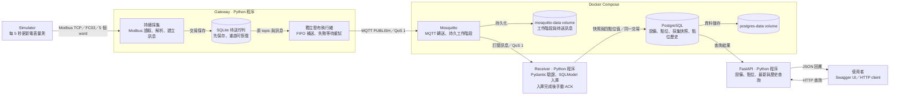
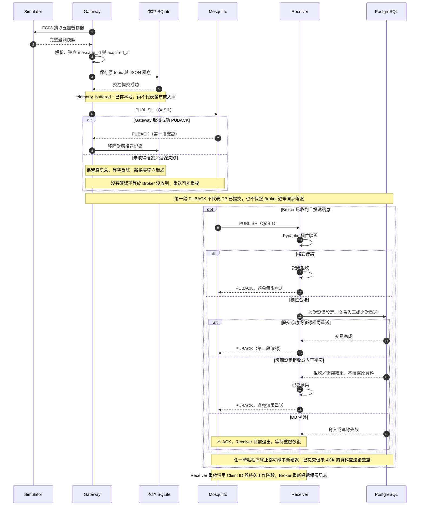

# 系統架構與可靠傳輸

此圖對應目前已實作的本機 Demo。Simulator、Gateway、Receiver 與 FastAPI 是分開執行的 Python 程序；Mosquitto 與 PostgreSQL 由 Docker Compose 啟動。圖中的分組表示程序與部署方式，不代表已部署多台主機。

## 整體架構

箭頭表示資料或儲存流向。主圖採 Gateway 持續模式，單次 publish_once 診斷模式不經 SQLite。

SQLite 是 Gateway 的本地檔案，不是另一個服務，也不是 PostgreSQL 的替代品。Mosquitto 的保存負責尚待交付的訊息；長期歷史查詢使用 PostgreSQL。FastAPI 只查 DB，不在請求內採集設備或訂閱 MQTT。

## 可靠傳輸流程

下圖將兩段 QoS 1 確認分開畫出。Gateway → Broker 與 Broker → Receiver 是獨立的傳遞；實際 PUBACK、轉送及入庫時序可以交錯，不以圖上的先後順序代表跨元件交易。

Receiver 不會向 MQTT Broker 查詢任意歷史；它恢復原工作階段，由 Broker 交付仍保留的訊息。DB 故障時，現有程式不 ACK 並退出，尚未加入持續退避重試。

## 保存與恢復的邊界

| 位置 | 已實作 | 限制／尚未配置 |
|---|---|---|
| Gateway SQLite | 預設最多 10,000 筆；未確認保留，重啟補送 | 容量滿淘汰最舊並記錄筆數；本地儲存失敗則停止；不涵蓋主機／磁碟損毀 |
| Mosquitto | 持久工作階段、volume、每客戶端最多 1,000 筆待送及 1 筆未確認 | 超量不保證補回；定期落盤不是逐筆同步保存；本地 10,000 筆不會提高 Broker 上限 |
| Receiver → DB | 同交易快照＋四點位值、去重、提交後 ACK | DB 持續故障的退避重試尚未實作；設定拒收等訊息確認後不自動補回 |
| Gateway 停機期間 | 重啟後繼續採集 | Simulator 沒有歷史補讀，未採集資料無法補造 |

細節與實際故障驗證見 [Receiver 恢復](verification/receiver-recovery.md)、[Gateway 離線補送](verification/gateway-offline-buffer.md)，設計決策見 [ADR-0005](decisions/0005-receiver-recovery.md)、[ADR-0006](decisions/0006-gateway-offline-buffer.md)。
