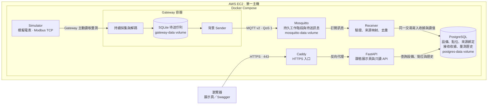
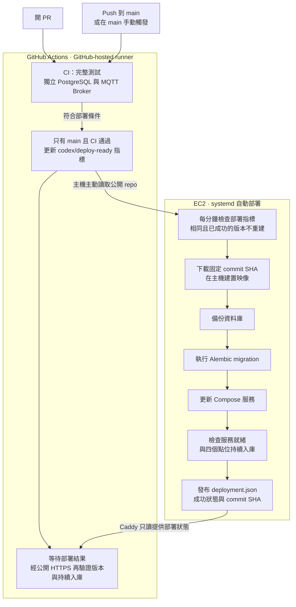

# 系統架構與可靠傳輸

目前線上展示在一台 AWS EC2（雪梨）執行，使用 Docker Compose 管理服務。Simulator 持續產生電表數值，Gateway 每 5 秒採集並透過 MQTT 發送，Receiver 映射平台點位後寫入 PostgreSQL，網頁透過 FastAPI 查詢已入庫的量測。

## 執行中的資料流

- **Simulator** 每 5 秒更新量測；Gateway 的採集週期各自設定。線上展示目前使用模擬設備，Gateway 另支援設定式的多設備 Modbus TCP／RTU 採集。
- **Gateway** 讀自己的 `appsettings.json`，管理通道、設備位址、Unit ID、點位位址與解碼；成功讀值先存 SQLite，再由 Sender 發布。
- **Receiver** 讀自己的平台設備、點位與來源綁定設定，不讀 Gateway 設定。來源設備 `meter-001` 的四個點位映射到平台「展示電表（site-001）」，兩者不是兩台正在採集的實體設備。
- **展示頁** 由 FastAPI 提供，不是獨立前端服務。每 5 秒查詢各點位最新值與最近 100 筆歷史，顯示卡片、趨勢圖與明細；頁面查詢成功不代表整條採集鏈路健康。

公開入口只有 HTTP／HTTPS，HTTP 轉址 HTTPS。SSH 限制管理者目前的 IP；DB、MQTT、Modbus 與 FastAPI 的直接主機連接埠只綁定 loopback，不對外開放。Caddy 的憑證保存在獨立 volume。

## 兩段確認與故障恢復

1. **Gateway → Broker**：SQLite 待送資料依 FIFO 發布；取得 Broker PUBACK 後才移除。Broker 離線或發布失敗時保留原 Topic、訊息 ID、值與時間，恢復後重試。
2. **Broker → Receiver → DB**：Receiver 驗證並映射來源，在同一交易保存最小收據與點位讀值；DB 提交後才 ACK。DB 例外不 ACK 並退出，使用相同接收身分重啟後恢復持久訂閱。

Gateway 的 PUBACK 不代表 DB 入庫。確認可能遺失，所以接收端以來源範圍內的訊息唯一鍵去重；相同 ID 但內容指紋不同則記錄衝突，不覆寫。重新綁定來源後，已處理訊息的重送也不會改寫原目的地。

格式錯誤、單位不符、完全無映射或內容衝突會記錄後 ACK，目前沒有拒收資料隔離佇列。Receiver 尚未在程序內自動重連；**雲端 Compose 的持續服務已設定 `restart: unless-stopped`**，讓程序退出後可由 Docker 重啟。本機預設 Compose 沒有這項重啟策略。

SQLite、Broker 與 DB 的 volumes 保留跨容器重建的資料；Gateway 容量滿時會淘汰最舊待送資料，Broker 的離線佇列也有上限。這些機制不保證主機／磁碟故障、容量淘汰或首次訂閱前的資料不遺失，也沒有跨主機容錯。

## 資料與查詢

PostgreSQL 使用以下五張業務表：

| 資料表 | 用途 |
|---|---|
| `devices` | 平台設備 |
| `measurement_points` | 設備的感測點、單位與解析度 |
| `source_bindings` | MQTT 來源與平台感測點的映射 |
| `received_messages` | 最小接收收據、來源識別與完整性指紋 |
| `readings` | 統一的點位量測歷史 |

收據不保存完整 payload 或 raw registers。舊快照已透過 migration `0003` 搬移／補齊點位值後移除；目前沒有 `telemetry_readings` 或 `mapped_point_readings`。

目前查詢 API 為 `/devices`、`/devices/{device_id}/points`、`/points/{point_id}/readings`。首頁 `/` 提供展示頁，`/assets/architecture.html` 提供架構圖展示，`/docs` 提供 Swagger。舊固定電表快照接口已移除。

## CI/CD：測試通過後由主機拉取版本

PR 只做 CI，不部署。CI 失敗不更新部署指標；migration 失敗不進行後續服務更新。部署失敗會留下狀態與 systemd 日誌，定時工作下一輪會重試。GitHub 的 deploy job 必須等到正確版本成功，且線上量測持續更新，才判定成功。

主機不安裝通用 GitHub Runner，也不需要 GitHub 向主機開啟 SSH 連線。正式密碼與 Receiver 私有設定留在主機，DB、Broker 與 Gateway volumes 沿用；程式映像以 commit SHA 區分。部署可能短暫中斷，沒有零停機或資料庫自動回滾保證。

部署檔、操作指令與更新器維護方式見 [雲端部署](../deploy/README.md)。

## 相關文件

[Gateway 設定](gateway/CONFIGURATION.md) · [Receiver 來源映射](receiver/SOURCE_MAPPING.md) · [MQTT v2 契約](mqtt/POINT_TELEMETRY_V2.md) · [資料結構](storage/SCHEMA.md) · [本機 Compose](verification/compose-deployment.md)
