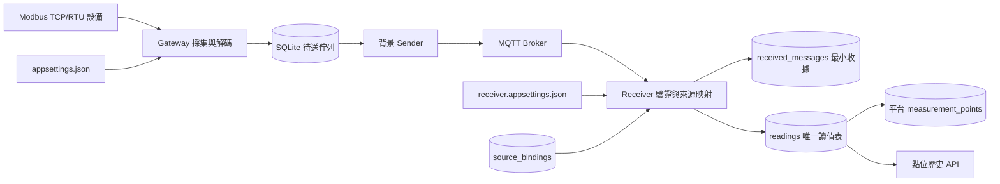

# 系統架構與可靠傳輸

Gateway 與 Receiver 使用各自的設定，只透過訊息契約與來源映射合作。

Gateway 管理通道、設備位址、Unit ID、點位位址與解碼。Receiver 管理自己的平台點位與來源綁定，不讀 Gateway 設定。來源 temp2 可以映射到平台 temp1；修改採集位址不影響接收端，重新綁定來源也不要求修改 Gateway。

## 兩段確認

1. Gateway 成功讀取的點位先保存至 SQLite，再由背景執行緒依 FIFO 發布。取得 Broker PUBACK 後才移除待送資料；失敗保留原 Topic、ID、值與時間重試。
2. Receiver 驗證並映射來源，在同一交易保存最小收據與點位讀值。DB 提交後才 ACK；DB 例外不 ACK 並退出，重啟後恢復持久訂閱。

Gateway 的 PUBACK 不代表 DB 入庫。確認可能遺失，所以接收端以來源範圍內的訊息唯一鍵去重；同 ID 內容指紋不同就記衝突，不覆寫。重綁後重送不改目的地，已有讀值與首次結果指紋不符則報錯。

格式錯誤、單位不符、完全無映射或內容衝突會記錄後 ACK；沒有拒收資料隔離佇列。Broker/DB 故障後 Receiver 仍需重啟，尚未自動重連。容量淘汰、主機/磁碟故障與首次訂閱前資料不在完整補送保證內。

## 不再保存固定快照

PostgreSQL 只有平台設備、點位、來源映射、最小訊息收據與統一 readings。沒有 telemetry_readings 或 mapped_point_readings；收據也不保存 payload/raw registers/重複的點位值。

舊 v1 相容入口先驗證舊電表格式，再轉成點位值，使用同一張 readings。歷史快照透過 0003 搬移/補齊點位值後移除。

## API 範圍

設備、點位與點位歷史維持原回應格式；點位歷史可查遷移的舊值與新 v2 值。兩個固定電表快照接口已移除，不出現在 Swagger；原路徑回標準 404。本階段沒有新增查詢功能或前端。

[Gateway 設定](gateway/CONFIGURATION.md)、[Receiver 來源映射](receiver/SOURCE_MAPPING.md)、[資料結構](storage/SCHEMA.md)。
