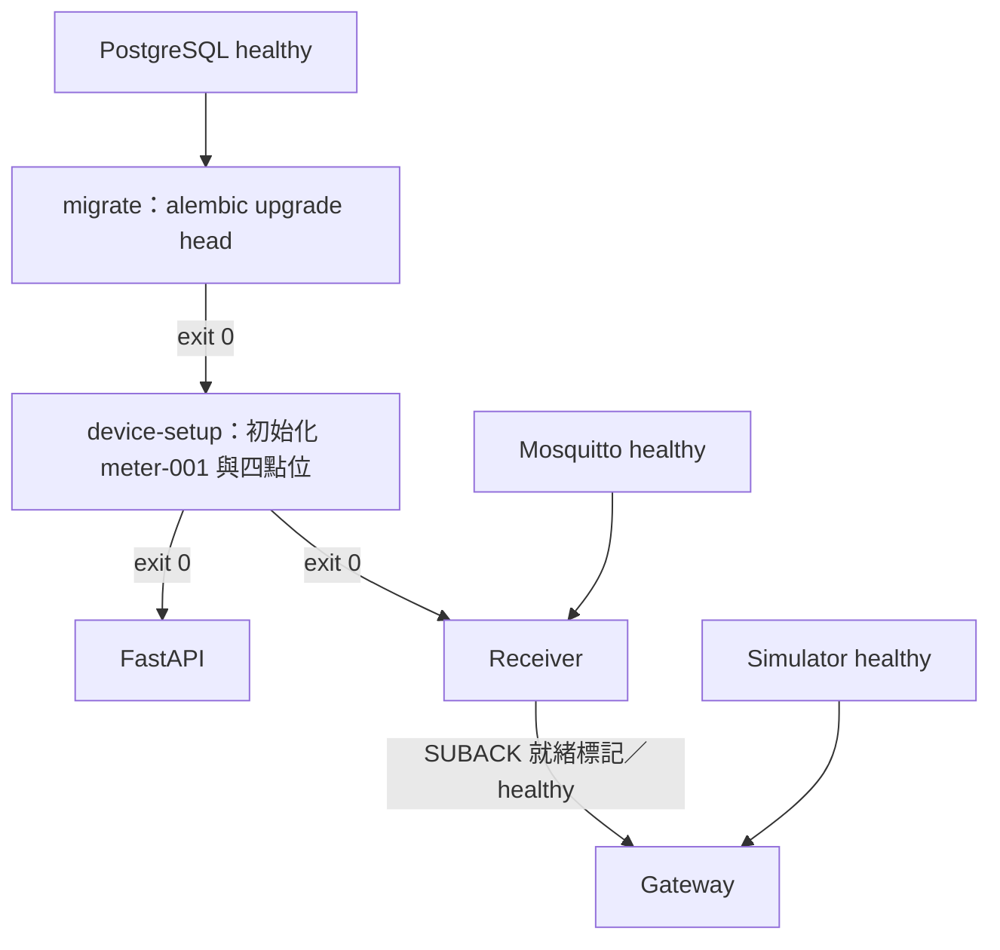

# Compose 部署與驗證

日期：2026-10-26。預設單機部署，六個常駐服務、兩個一次性工作。

## 啟動與依賴

```powershell
docker compose up -d --build --wait
```



migrate、device-setup 的 Exited (0) 表示完成。首次建立時 migration 失敗，初始化、Receiver、API 及 Gateway 不會繼續啟動；不把此相依機制當成更新中的舊服務自動下線或資料庫自動回滾。

目前不設定容器自動重啟策略。健康檢查、啟動順序與故障恢復是不同機制；Broker／DB 故障造成 Receiver 退出後仍需重新啟動，不能因容器化宣稱已有自動恢復或跨主機備援。

| 檢查 | 內容 |
|---|---|
| PostgreSQL | pg_isready |
| Mosquitto | 發布非業務 health topic，等待 QoS 1 確認 |
| Simulator | 本機 Modbus TCP port 可連線 |
| Receiver | SUBACK 成功後建立 --ready-file；啟動前清除舊標記，退出時清除 |
| API | HTTP GET /devices，會實際查 DB |
| Gateway | 沒有額外健康探測；Compose wait 只確認程序執行，資料流另由入庫／查詢驗證 |

Receiver 就緒檔案不是 DB 健康或入庫成功證明。啟動閘門確保首次發布前已建立訂閱；之後仍以 PUBACK、DB 提交與訊息保留規則分別判定結果。

## 映像、網路與保存

Dockerfile 使用 python:3.12.14-slim，安裝原 requirements.txt，共用映像但分容器執行。應用以 UID/GID 10001 執行，/app/data 可寫；不更動本機 .venv。不新增 Python 套件，間接相依仍由 requirements 的版本範圍解析，並未新增完整 lockfile。

.dockerignore 採允許清單；僅加入程式、migration、測試與公開 telemetry 範例。Git、.venv、local-notes、.env 與本地量測不進入建置內容。

容器內以服務名稱連線：Gateway → simulator:1502／mosquitto:1883，Receiver → mosquitto:1883／postgres:5432，API 與 migration → postgres:5432。127.0.0.1 的 host 對外埠不作為容器間位址。

| Volume | 保存內容 |
|---|---|
| postgres-data | PostgreSQL 資料 |
| mosquitto-data | Broker 工作階段及待送狀態 |
| gateway-data | /app/data/gateway-001-outbox.sqlite3 |

```powershell
docker compose down
```

down 保留 volumes；down -v 會刪除這些資料。主機 data/ 和 Docker gateway-data 是不同儲存，不自動搬移。首次從本機模式切換前，先處理原待送資料，再停止四個手動 Python 程序，避免相同設備／Client ID 被同時使用。

環境變數只調整 host 映射，不改容器內連接埠：

| 變數 | 預設 |
|---|---|
| MQTT_PORT | 1883 |
| POSTGRES_PORT | 15433 |
| MODBUS_PORT | 1502 |
| API_PORT | 8000 |
| APP_IMAGE | okgo-demo-app:local |

例如只改 API 對外埠：

```powershell
$env:API_PORT = '18000'
docker compose up -d --build --wait
```

使用自訂埠時請保留同一終端環境，或自行在本地 .env 設定；測試不同環境時也使用不同 -p 專案名稱，使 volumes、網路與 Client ID 所屬 Broker 隔離。

## 日常操作

```powershell
docker compose ps -a
docker compose logs -f gateway receiver
```

Ctrl+C 結束 logs 追蹤不會停止服務。容器停止使用 SIGINT，讓 Python 清理 MQTT、SQLite 與就緒標記；最長等待 30 秒，超過後 Docker 仍可能強制終止。

更新程式／migration 後重跑 up -d --build --wait；不是每個應用實例自行升版。另行維護資料庫可用：

```powershell
docker compose run --rm migrate
```

這會對目前配置 DB 升版；一般完整啟動已自動執行，不必重複手動跑。升版與備份政策仍需依實際資料庫維護要求處理。

## 已執行的隔離驗收

使用 okgo-compose-check- 開頭的獨立專案、獨立 host ports、共用測試映像與三個新 volumes，沒有替換展示服務或使用展示 DB。

1. 從空 volumes 執行 up -d --build --wait：migration=0002、migrate/device-setup exit 0，Receiver healthy 後啟動 Gateway，API healthy。
2. 驗證動態採集、四個感測點、快照、點位歷史、最新值等五支資料 API；每份快照對應四筆點位值。
3. 驗證映像內不包含 .git、.venv、local-notes、.env。
4. Broker 停機時累積三筆 SQLite 待送資料；移除全部容器及網路但保留 volumes，再次啟動。原有 35 份快照、點位 ID、Broker 持久工作階段與待送資料均保留；三筆原 ID／取得時間／數值成功補收入庫。
5. 另一個全新隔離專案將 migration 目標改為不存在的 revision：Compose 回報非零，設備初始化、Receiver、API、Gateway 均未運行；失敗測試專案已清理。
6. 主機 Python 對專用測試 DB／Broker 執行完整回歸：139 項通過、無跳過。
7. 新建 Linux 映像內另以專用 DB 驗證：134 項通過、5 項需本機獨立 Broker 的恢復驗證跳過。這五項已於上一項完整環境執行，不把容器內跳過算成通過。

既有 Starlette TestClient／HTTPX 相容性警告仍存在，測試通過；本次未更改 requirements 的直接版本。沒有建立遠端 CI。
